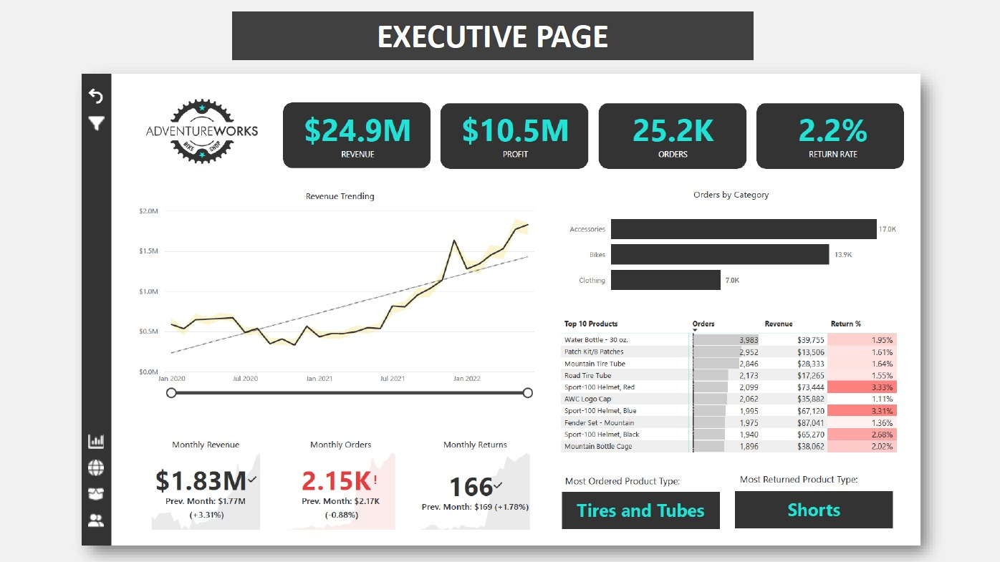
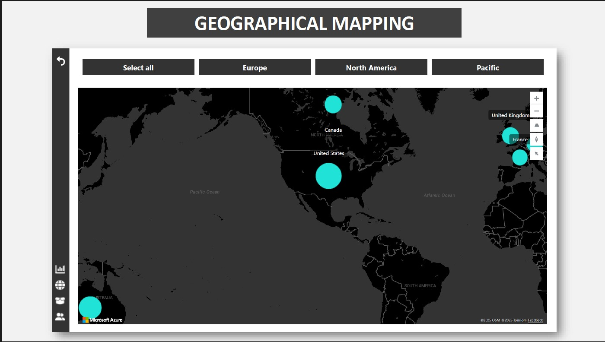
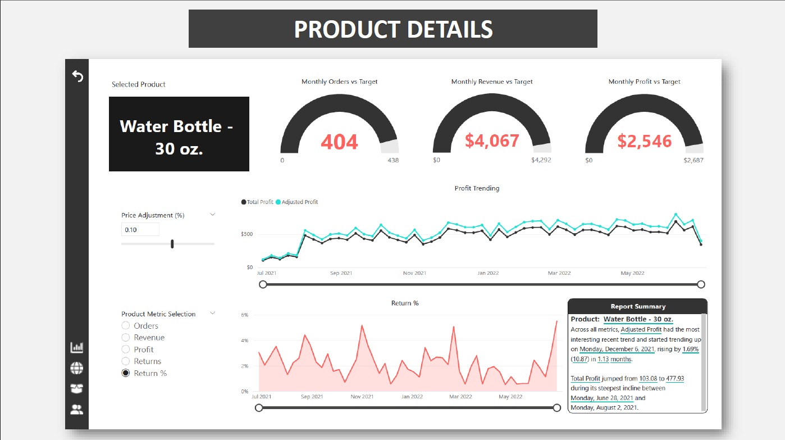
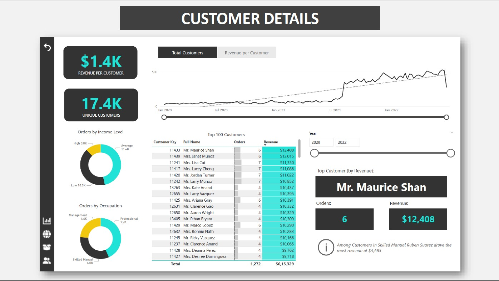
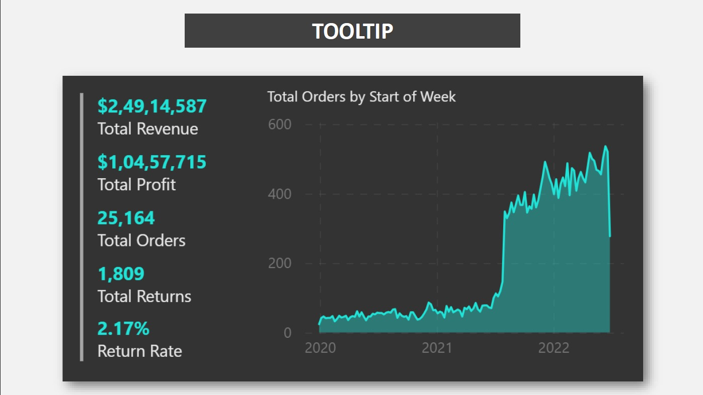

# AdventureWorks Sales Analysis Dashboard \| Power BI

An interactive Power BI dashboard built to explore AdventureWorks sales
performance across revenue, profit, orders, product returns, geography,
and customer behavior.

## Project Overview

This project presents business performance through multiple report
pages. Users can move from a high-level executive summary to geographic,
product-level, and customer-level analysis.

## Dashboard Pages

### 1. Executive Summary

-   Revenue, profit, orders, and return-rate KPI cards
-   Revenue trend over time
-   Orders by product category
-   Top products by orders, revenue, and return percentage
-   Monthly revenue, orders, and returns comparisons
-   Most ordered and most returned product types

### 2. Geographical Mapping

-   Interactive map to explore sales across regions
-   Region filters for Europe, North America, and Pacific
-   Geographic comparison of market activity

### 3. Product Details

-   Selected-product overview
-   Monthly orders, revenue, and profit versus target
-   Profit trend with total and adjusted profit
-   Return-rate trend
-   Price-adjustment parameter to explore profit scenarios
-   Product metric selector for orders, revenue, profit, returns, and
    return rate
-   Automated report-summary text for the selected product

### 4. Customer Details

-   Unique customer and revenue-per-customer KPIs
-   Customer trend over time
-   Orders by income level and occupation
-   Top customers by orders and revenue
-   Year filter and customer-level detail

### 5. Tooltip Page

-   Contextual KPI summary for revenue, profit, orders, returns, and
    return rate
-   Trend chart for orders by week
-   Designed to provide extra detail when users hover over visuals

## Key Insights Shown in the Report

-   The executive page highlights approximately **\$24.9M revenue**,
    **\$10.5M profit**, **25.2K orders**, and a **2.2% return rate**.
-   Accessories lead order volume in the category comparison shown on
    the executive page.
-   The product detail page allows performance and return trends to be
    examined for an individual product.
-   Customer analysis supports comparisons by income level, occupation,
    year, and customer.
-   The geographic page provides regional exploration across Europe,
    North America, and Pacific.

*Figures above are transcribed from the supplied dashboard preview. KPI
values may differ between report pages because of filters, measure
definitions, or formatting.*

## Tools and Features

-   Microsoft Power BI
-   Interactive slicers and filters
-   KPI cards
-   Line and area charts
-   Bar charts and doughnut charts
-   Conditional formatting
-   Drill-through-style product and customer analysis
-   What-if price adjustment parameter
-   Custom tooltip page

## Repository Structure

``` text
AdventureWorks-Power-BI-Dashboard/
├── README.md
├── images/
   ├── executive-summary.png
   ├── geographical-mapping.png
   ├── product-details.png
   ├── customer-details.png
   └── tooltip.png

```


## Screenshots

Add exported dashboard screenshots

### Executive Summary



### Geographical Mapping



### Product Details



### Customer Details



### Tooltip



## Business Questions

This dashboard is designed to help explore questions such as:

-   How are revenue, profit, orders, and returns changing over time?
-   Which product categories and products generate the most orders or
    revenue?
-   Which products have comparatively high return rates?
-   How does product performance compare with targets?
-   Which customer segments and individual customers contribute most to
    revenue?
-   How does performance vary across geographic regions?


## Author

**Raiful Islam Ratul**

Data Analytics \| Power BI \| Excel \| SQL \| Python
